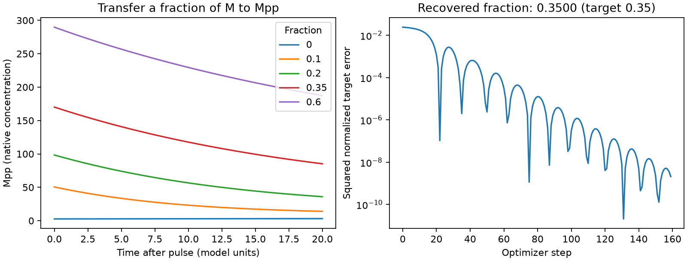

# Current JAX migration and independent validation

This fork targets Python 3.12+ and JAX **0.12.0.1**. The checked-in `uv.lock`
resolves matching JAX/JAXlib 0.12.0.1, Diffrax 0.7.2, Equinox 0.13.8 and Optax
0.2.8. JAX supplies its compatible JAXlib requirement. Simulation uses CPU,
float64, Kvaerno5 and relative/absolute tolerances `1e-9`/`1e-11`.

The starting point is AbeelLab/jaxkineticmodel commit
`2247707c052e98d6bf548ccfa02fffb2c6288312`. Its JAX 0.4.35 pin prevents installing
the modern stack. This branch updates the dependency bounds and Python floor,
and checks numerical behavior against independent programs rather than treating
a successful import as sufficient evidence.

## Reproduce

From the repository root:

```sh
uv sync --python 3.12 --locked --group validation
MPLBACKEND=Agg JAX_PLATFORMS=cpu uv run --locked --group validation python -m pytest -q
uv run --locked --group validation python -m validation.conformance
MPLBACKEND=Agg uv run --locked --group validation python -m validation.mapk_intervention
```

The oracle group adds RoadRunner 2.11.0 and COPASI 4.48.311 via BasiCO 0.92;
they remain optional development dependencies. No model downloads are needed.
[Fixture provenance and math](../tests/fixtures/conformance/README.md) explain
the reused analytic cases and five BioModels files. SHA-256 checks ensure that
the biological XML inputs have not been changed to obtain agreement.

## What the cases found

Running the imported models on the new stack exposed existing loader behavior
independent of the dependency constraint:

- Constant enzymes with `boundaryCondition=false` were excluded from both the
  state and constant substitutions, causing missing-symbol errors in models
  27, 29 and 31. Both types of fixed species now enter the substitution table.
- The solver divided every reaction derivative by compartment volume. An SBML
  species with `hasOnlySubstanceUnits=true` denotes an amount, so its derivative
  is `N v`, while a concentration derivative is `N v / V`. Physical compartment
  sizes remain available separately. Initial values and exported initial values
  now follow the same amount/concentration convention.
- Constructing a second kinetic model mutated/reused already compiled flux
  functions. Each model now receives a copy of the symbolic flux dictionary.
- Rate rules were treated as assignments. Unsupported rate/algebraic rules now
  fail explicitly; they are not claimed as newly supported.

For example, the two-litre constant-decay fixture previously returned
`A(1) = 2 exp(-1/2) = 1.213061` instead of `2 exp(-1) = 0.735759`.
This is an equation error, not an integration-tolerance problem.

## Numerical results

The [saved report](results/report.json) contains **87 passing comparisons**:
six analytic cases at two output grids, checked three ways against exact
solutions and three pairwise engine comparisons; and five biological baselines
with three pairwise comparisons each. The worst tolerance-normalized error is
approximately **0.00311**, where 1 is the failure boundary. Acceptance is
`abs(a-b) <= 1e-7 + 2e-5 * max(abs(a), abs(b))` at every sampled value.

Tests additionally cover JIT/vmap, an exact parameter gradient, nonzero restart
time, Optax updates in linear and logarithmic parameter space, and all four
combinations of amount/concentration symbols and initial-value encodings,
including SBML export/reimport. Assigned species outputs beyond the dynamic
states, events, general rate rules, variable volumes and arbitrary SBML remain
outside this evidence.

The existing random DBTL documentation example initially exhausted the solver
step budget for some sampled strains, then supplied NaN labels to XGBoost.
Its demonstration now uses a fixed seed, smaller additive promoter increments,
24 training strains, 12 validation strains, a 1000-unit observation window and
one XGBoost thread. It explicitly checks that simulated labels are finite before training. This
changes that example's sampling distribution; it does not establish correctness
or convergence for broad arbitrary parameter searches.

## A biological intervention with validated gradients

[mapk_intervention.py](mapk_intervention.py) uses BioModel 31. After 50 model-time
units of untreated evolution, transfer a fraction `f` of unphosphorylated MAPK
to doubly phosphorylated MAPK:

```text
M_after   = (1-f) M_before
Mpp_after = Mpp_before + f M_before
Mp_after  = Mp_before
```

This preserves `M + Mp + Mpp` and allows a controlled intervention without
injecting extra MAPK. Five trajectories run through `jit(vmap(...))` and agree
with independent RoadRunner and COPASI restarts. The response is Mpp twenty
time units after the pulse. At `f=0.2`, autodiff gives approximately **272.510407**;
centered differences from both independent simulators agree at step sizes
`1e-3`, `1e-4`, and `1e-5`.

For an attainable synthetic target generated using `f=0.35`, an Optax optimizer
starting at `f=0.05` recovers approximately **0.349961**. The loss falls from
0.0243 to 8.24e-10. The sigmoid parameterization keeps the fraction in (0,1).
This demonstrates intervention fitting in a specified model; it is not evidence
of biological learning, parameter identifiability, or an experimentally feasible
phosphorylation pulse. See the [example report](results/mapk_intervention.json).



The separate [GRN_ODE replication](https://github.com/m9h/GRN_ODE/pull/1) adds this
backend to its eight memory experiments, retaining the original reset schedules,
matched controls, classification criteria and unchanged model inputs.
